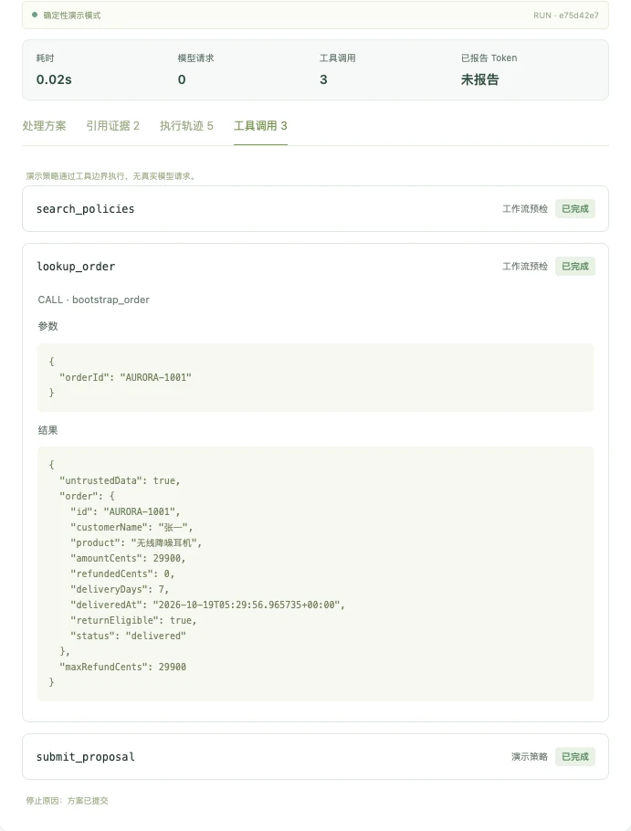
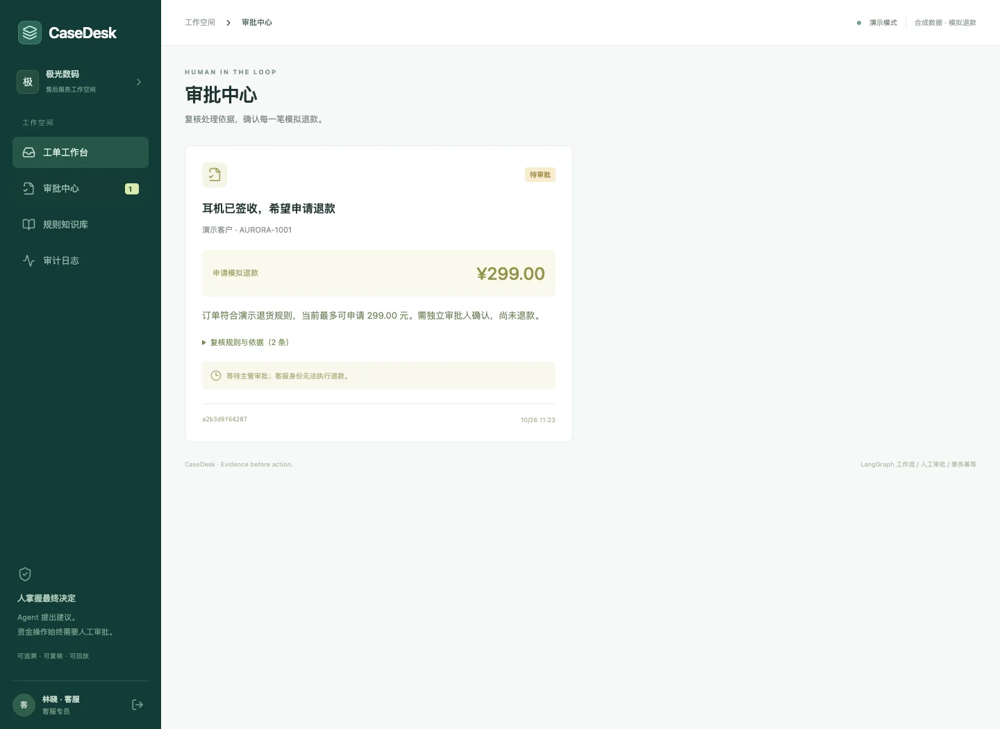
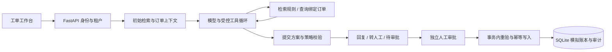

# CaseDesk · 企业售后工单 Agent

[](https://github.com/1766421040-ux/casedesk-agent/actions/workflows/ci.yml)
[](LICENSE)

**让模型查规则、查订单、提出方案；让业务系统负责权限、审批与执行。**

A support-agent workbench with bounded tool use, versioned evidence and human-approved actions.

CaseDesk 面向电商售后场景：客服收到退款、物流、质保或发票工单，Agent 获取当前租户的政策与订单，生成可核对的建议。涉及退款时，方案进入独立人工审批；批准时再次检查规则版本、订单余额与预算，最后写入模拟账本。

默认离线运行，无需模型 Key。也可接入支持工具调用的 Chat Completions 模型。项目使用合成客户与订单，退款不接真实支付。

[快速启动](#快速启动) · [10 分钟演示](docs/十分钟演示.md) · [架构与设计](docs/架构与验收.md) · [验证记录](docs/验收记录.md) · [真实模型评测](docs/真实模型评测清单.md)


## 一张工单如何被处理

> **客户：**“耳机签收 7 天，商品未使用，希望申请退款。”
> **关联订单：**`AURORA-1001`，实付 ¥299，当前可退。

1. 获取退款政策片段，记录文档、版本和引用 ID；读取工单绑定订单。
2. 模型可在允许范围内补充检索与查单，然后提交 `refund / reply / abstain` 方案。
3. 服务端核验引用、动作和整数金额。有效退款提议进入“待审批”，此时账本没有变化。
4. 另一位审批主管核对证据后批准。事务内重验通过才写入 ¥299 模拟退款；重复提交不重复记账。
5. 历史方案、工具调用、审批意见和审计事件持续可查。工单修改与政策更新保留版本，不覆盖旧证据。

已被拒绝的工单可以重开后补充资料；普通咨询可以人工结案。规则发生变化时，旧方案需重新核实，再次生成建议。

## 值得检查的三个设计

| 设计 | 具体做法 | 代码入口 |
|---|---|---|
| **受控工具循环** | LangGraph 固定外层阶段；模型在 `draft` 中调用规则检索、绑定订单查询与方案提交工具。工具有参数校验、租户范围、调用预算和轨迹，模型没有退款执行工具 | [`agent.py`](backend/app/agent.py) |
| **版本化业务上下文** | 工单编辑使用版本冲突检查；规则发布保留历史版本与片段。历史 run 保留当时证据，批准时重新检查当前政策 | [`main.py`](backend/app/main.py)、[`db.py`](backend/app/db.py) |
| **人工决定与事务执行** | 客服提案、独立 reviewer 决策。审批事务共同写入订单、模拟账本、工单状态、幂等响应和审计，处理重复请求和并发余额竞争 | [`main.py`](backend/app/main.py)、[`test_api.py`](backend/tests/test_api.py) |

工作台包含工单检索与筛选、编辑和结案、证据与运行轨迹、审批中心、规则版本管理及审计查询。前端使用 React / TypeScript；服务端使用 FastAPI、SQLite 与 BM25 检索。

<details>
<summary>查看执行轨迹与审批界面</summary>





</details>

## 快速启动

准备 **Python 3.12、Node.js 22.12+、Git**。以下为 macOS / Linux / WSL 路线，命令从克隆开始顺序执行；首次安装依赖需要网络。

```bash
git clone https://github.com/1766421040-ux/casedesk-agent.git
cd casedesk-agent
python3.12 -m venv .venv
.venv/bin/python -m pip install -r backend/requirements-lock.txt
npm --prefix frontend ci
CASEDESK_PROVIDER=demo bash scripts/dev.sh
```

打开 **[工作台 http://127.0.0.1:5173](http://127.0.0.1:5173)**；API 文档在 [http://127.0.0.1:8000/docs](http://127.0.0.1:8000/docs)。脚本同时启动前后端，Ctrl+C 停止，重启保留已有数据。

| 工作空间 | 客服账号 | 审批主管账号 |
|---|---|---|
| 极光数码 | `agent@aurora.demo` | `reviewer@aurora.demo` |
| 海港生活 | `agent@harbor.demo` | `reviewer@harbor.demo` |

演示密码均为 **`DemoPass!2026`**。先使用极光数码客服登录，选择耳机退款工单，运行 Agent 并查看方案、引用和工具轨迹；再退出切换主管，在审批中心批准。默认账户和服务仅适合本地演示。

想按顺序复现退款、政策变化、重新处理与租户隔离，使用 [10 分钟演示脚本](docs/十分钟演示.md)。脚本包含确定的订单、输入和预期状态，以及从已有演示数据重新开始的方法。Windows 原生启动与配置说明见 [后端 README](backend/README.md)。

## Agent 如何运行



两种 provider 共用业务校验与审批路径：

| 模式 | 行为 | 适合用途 |
|---|---|---|
| `demo`（默认） | 确定性规则生成建议，经同一工具执行和方案校验边界；不调用模型 | 无 Key 演示、工程回归、复现业务状态 |
| `openai-compatible` | 模型通过 `tools / tool_calls / tool_call_id` 交互补查资料并提交方案；受次数、参数与时间预算约束 | 验证真实模型协议和开展单独的效果评测 |

外层图是 `intake → retrieve → order_lookup → draft → policy_guard`，动态工具循环位于 `draft` 内。人工审批发生在图结束后的独立 API 中；历史回放只读取保存结果，不重新执行工具。详见 [状态机、工具边界与事务设计](docs/架构与验收.md)。

## 接入真实模型

在启动后端的同一终端设置：

```bash
export CASEDESK_PROVIDER=openai-compatible
export CASEDESK_MODEL_BASE_URL=https://your-provider.example/v1
export CASEDESK_MODEL_NAME=your-tool-capable-model
export CASEDESK_MODEL_API_KEY=your-key
bash scripts/dev.sh
```

`BASE_URL` 是以 `/v1` 等路径结束的服务根地址，程序追加 `/chat/completions`。端点应支持函数工具调用及工具结果消息；服务也兼容返回最终结构化 JSON，并通过同一个方案提交边界校验。先确认供应商的模型能力，再用合成数据测试。

模型会收到当前工单、同租户规则片段和订单摘要。凭据只在服务端使用。开发脚本不自动读取 `.env`；shell 使用上面的 `export`，Docker Compose 可读取仓库根目录的 `.env`。完整配置、协议和错误处理见 [后端说明](backend/README.md)。

真实模型的质量、延迟与成本需要单独测量；[评测清单](docs/真实模型评测清单.md) 给出联网运行命令、留出集设计和评分规则。

## 验证与证据

完成依赖安装后，从仓库根目录执行：

```bash
# 后端契约、权限、工具协议、版本冲突和事务回归
(cd backend && ../.venv/bin/python -m pytest -q)
# 固定合成场景，默认离线，数据库隔离
(cd backend && ../.venv/bin/python evaluate.py)
# 前端格式、类型检查与生产构建
(cd frontend && npm run format:check && npm run build)
# 浏览器业务闭环，使用单独测试端口和临时数据库
(cd frontend && npx playwright install chromium && npm run test:e2e)
```

| 证据 | 查看位置 | 结果含义 |
|---|---|---|
| 本轮实际运行、环境和未验证项 | [验收记录](docs/验收记录.md) | 已运行检查与计划分开记录 |
| 合成场景逐条结果 | [eval-demo.json](backend/evidence/eval-demo.json) | 确定性 demo 回归，不是模型准确率 |
| 后端与浏览器测试代码 | [backend/tests](backend/tests)、[frontend/tests](frontend/tests) | 可复核输入、断言和失败条件 |
| 远程构建与测试 | [GitHub Actions](https://github.com/1766421040-ux/casedesk-agent/actions/workflows/ci.yml) | 以对应提交的实际运行状态为准 |

CI 配置包含 pytest、合成场景、前端检查、Chromium 闭环测试，以及 Docker 构建、容器启动、Nginx 代理与后端重启后的持久化检查。测试使用临时数据库；E2E 端口为 `8001 / 5174`，不会复用日常演示的 `8000 / 5173`。

## Docker 运行

已安装并启动 Docker Engine / Docker Desktop 与 Compose 后，在仓库根目录执行：

```bash
docker compose up --build
```

访问 [http://127.0.0.1:8080](http://127.0.0.1:8080)。Nginx 提供静态前端与 `/api` 代理，后端单 worker，数据库保存在命名 volume `casedesk-data`。`docker compose down` 停止容器并保留数据。模型配置可从 `.env.example` 复制为 `.env` 后填写；不要提交凭据。

## 仓库导航

```text
backend/
  app/              API、业务状态、工具循环、模型协议、鉴权与数据模式
  tests/            工具协议、租户、审批、并发和恢复测试
  evals/            固定合成案例
  evidence/         可复核的场景运行报告
  evaluate.py       使用临时数据库的场景评估入口
frontend/
  src/              工单、审批、规则、审计与运行轨迹界面
  tests/            Playwright 浏览器业务回归
docs/               架构、演示脚本、验收和评测说明
scripts/            本地统一启动、容器运行与持久化检查
compose.yaml        本地容器部署
UPSTREAM.md         开源依赖、设计参考与贡献边界
```

## 当前范围与取舍

- **本地应用部署：** SQLite、单应用 worker、同步运行。服务重启后保留记录，并将中断的运行标为失败；没有任务队列、断点续跑或多实例调度。
- **可解释的检索基线：** 中文双字切分 + 英文 token 的 BM25，结合业务意图筛选；没有向量检索、文档上传解析或重排器。
- **明确的业务策略：** 30 天窗口、单笔 ¥500 上限、每租户 ¥1,000 累计演示预算由服务端执行。退款政策正文受保护；发布标题新版本不修改这些代码约束。
- **可复核但有限的证据：** 引用范围与版本会检查，逐句语义是否被证据支持仍需人工或独立评测。应用内追加审计不等于外部不可篡改日志。

下一步优先补真实模型留出评测，再根据失败类型决定检索或工具策略改进。账号管理、外部支付与物流、生产部署治理属于独立扩展范围。

## 来源与参与

CaseDesk 使用 LangGraph、FastAPI、rank-bm25、React 和 Playwright 等开源库。业务模型、工单界面、工具约束、审批事务及验收场景在本仓库实现，开发使用 AI 编程辅助。上游依赖、参考机制和未引入的系统见 [UPSTREAM.md](UPSTREAM.md)；本仓库采用 [MIT License](LICENSE)。

报告问题时请附运行模式、复现输入、预期/实际状态和脱敏错误。修改业务或工具契约时，同时更新相应测试与文档。面试介绍和源码阅读路线见 [面试讲解与项目边界](docs/面试讲解与项目边界.md)。
