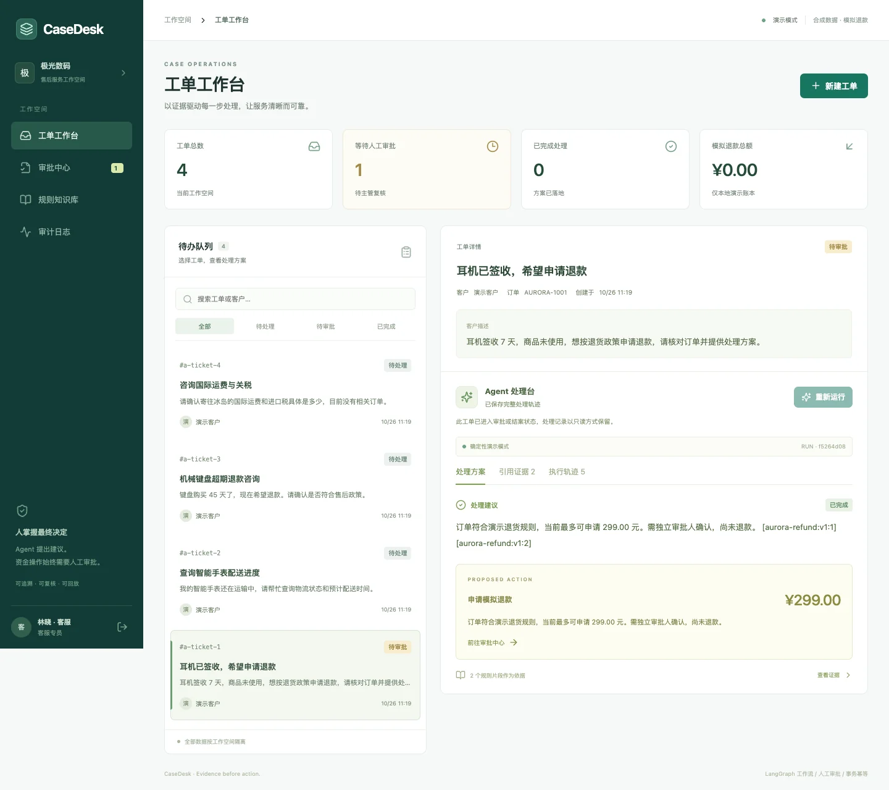
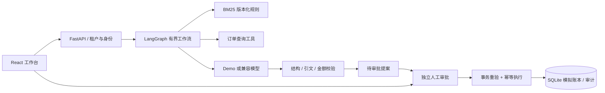

# CaseDesk · 企业售后工单 Agent

[](https://github.com/1766421040-ux/casedesk-agent/actions/workflows/ci.yml)

**证据先行，操作有界，决策留痕。**

CaseDesk 将售后问题变成可以复核的处理方案：检索规则、查询订单、生成带引用的提案，由独立审批人确认后写入模拟退款账本。它是面向 Agent 应用工程的完整本地作品，包含 React 工作台、FastAPI 服务、LangGraph 流程、数据库、测试与部署文件。



> 默认无需 API Key，以确定性规则演示完整流程；并提供真实模型兼容接口。演示数据全部合成，退款仅写入本地账本。工程回归结果不等于真实大模型任务成功率。本项目使用 AI 辅助开发；开源复用与原创范围见 [UPSTREAM.md](UPSTREAM.md)。

## 为什么做这个项目

普通问答只需要“生成回复”；售后系统还必须回答：依据哪版规则？订单是否属于当前租户？金额是否仍可退？谁批准的？重试会不会重复退款？模型失败之后还能否追踪？

CaseDesk 把这些问题放进实际业务闭环，避免只展示一个聊天窗口。

| 能力 | 可检查的实现 |
|---|---|
| 有界 Agent 流程 | 真正使用 LangGraph 五节点 StateGraph；模型输出 schema 受控 |
| 有依据的建议 | 中文双字切分 + BM25；规则片段、文档版本、回答引用一致性校验 |
| 人工审批 | 客服提案、独立 reviewer 审核；同人不能自审 |
| 事务与幂等 | `BEGIN IMMEDIATE` 中重验金额/资格/预算，原子写入账本、状态、审计与幂等响应 |
| 多租户隔离 | 每个资源查询、订单关联及审批均限定登录租户 |
| 可观察与恢复 | 节点输入/输出/耗时持久化；服务重启保留历史，未完成运行标记失败 |
| 完整工作台 | 工单创建/检索、证据面板、历史轨迹、审批、知识库、审计、响应式布局 |
| 两种 provider | `demo` 离线演示；`openai-compatible` 连接支持 JSON 输出的 Chat Completions 端点 |

## 运行

需要 Python 3.12+、Node.js 22.12+。macOS / Linux / WSL：

```bash
git clone https://github.com/1766421040-ux/casedesk-agent.git
cd casedesk-agent
python3 -m venv .venv
.venv/bin/python -m pip install -r backend/requirements-lock.txt
cd frontend
npm ci
cd ..
bash scripts/dev.sh
```

打开 [本地工作台](http://127.0.0.1:5173)。API 文档位于 [Swagger UI](http://127.0.0.1:8000/docs)。按 Ctrl+C 停止前后端。脚本不会清除数据库。Windows 可以在两个终端分别启动 `uvicorn` 与 `npm run dev`，具体见 [后端说明](backend/README.md)。

| 身份 | 账号 | 密码 |
|---|---|---|
| 极光数码 · 客服 | `agent@aurora.demo` | `DemoPass!2026` |
| 极光数码 · 审批主管 | `reviewer@aurora.demo` | `DemoPass!2026` |
| 海港生活 · 客服 | `agent@harbor.demo` | `DemoPass!2026` |
| 海港生活 · 审批主管 | `reviewer@harbor.demo` | `DemoPass!2026` |

这些账户仅用于本地演示，默认服务绑定回环地址。不要直接将默认账户暴露到公网。

## 五分钟演示

1. 客服登录，选择退款类种子工单，点击“运行 Agent”。
2. 查看处理方案、引用证据和五个执行步骤；此时只有待审批提案，没有退款。
3. 退出，切换审批主管，进入审批中心，展开规则证据并填写审批意见。
4. 批准后查看账本总额与审计记录；重新读取历史只展示保存内容，不重放工具。
5. 切换海港生活租户，确认看不到极光数码工单。再运行超期退款、证据不足、注入指令案例观察失败边界。

## 接入真实模型

仅服务端读取凭据。启动服务前设置环境变量；`.env.example` 是参考，开发脚本不会自动执行任意 `.env` 内容。

```bash
export CASEDESK_PROVIDER=openai-compatible
export CASEDESK_MODEL_BASE_URL=https://your-provider.example/v1
export CASEDESK_MODEL_NAME=your-model
export CASEDESK_MODEL_API_KEY=your-key
bash scripts/dev.sh
```

端点需要支持 `response_format: {"type":"json_object"}`。当前工单、同租户规则片段和订单摘要会发往配置的供应商。API Key 不进入前端和审计记录。非法 JSON、越界引用、越权动作、超限金额、超时或供应商错误都不会触发退款。实现与超时边界见 [后端说明](backend/README.md)。

## 验证

```bash
# 后端安全/事务/并发/模型适配测试（临时数据库）
(cd backend && ../.venv/bin/python -m pytest -q)
# 固定合成场景评估；默认离线、临时数据库
(cd backend && ../.venv/bin/python evaluate.py)
# TypeScript + 生产构建
(cd frontend && npm run build)
# 浏览器闭环回归；测试服务使用独立临时数据库
(cd frontend && npx playwright install chromium && npm run test:e2e)
```

实测结果与范围见 [验收记录](docs/验收记录.md)，原始合成评估结果见 [eval-demo.json](backend/evidence/eval-demo.json)。CI 在每次 push / PR 上运行后端测试、场景评估、前端构建和浏览器回归。

## Docker

```bash
docker compose up --build
```

访问 [Docker 工作台](http://127.0.0.1:8080)。Nginx 提供静态前端和 `/api` 反向代理，后端单 worker，SQLite 存放在命名 volume。可复制 `.env.example` 为 `.env` 后配置模型。[首次 GitHub CI](https://github.com/1766421040-ux/casedesk-agent/actions/runs/40264557555) 的应用测试与两个 Docker 镜像构建均已通过。本地未运行 Docker 容器，镜像构建成功不等于生产部署验收。

## 架构与限制



当前是固定流程 Agent 工程：不包含模型自主多步规划、多 Agent、MCP、向量数据库、后台任务队列、SSE、LangGraph checkpoint/interrupt 或真实支付。SQLite 使用单应用进程，不能据此声称支持高并发生产部署。注入检测是辅助机制，可靠权限边界在业务后端。引用合法不保证回答每个语义断言都正确，仍需人工复核。

下一阶段应先做真实模型分层评测，再按结果决定是否增加工具选择循环、混合检索/重排与持久化任务队列；不应只增加框架数量。规则版本编辑、权限管理、数据库迁移、分页和跨实例部署也属于后续工作。

- [架构、状态机与验收方法](docs/架构与验收.md)
- [面试讲解与项目边界](docs/面试讲解与项目边界.md)
- [上游开源项目和贡献边界](UPSTREAM.md)
- [后端 API / 配置](backend/README.md)

MIT License。
