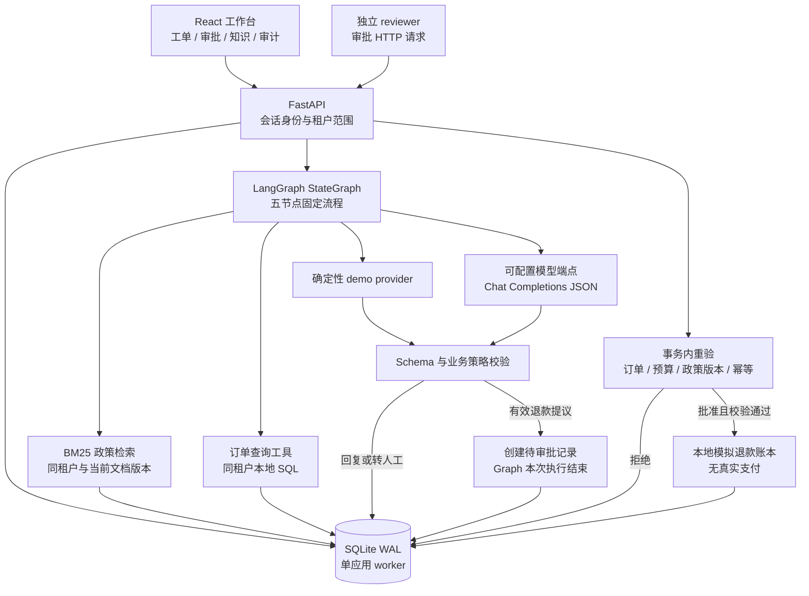
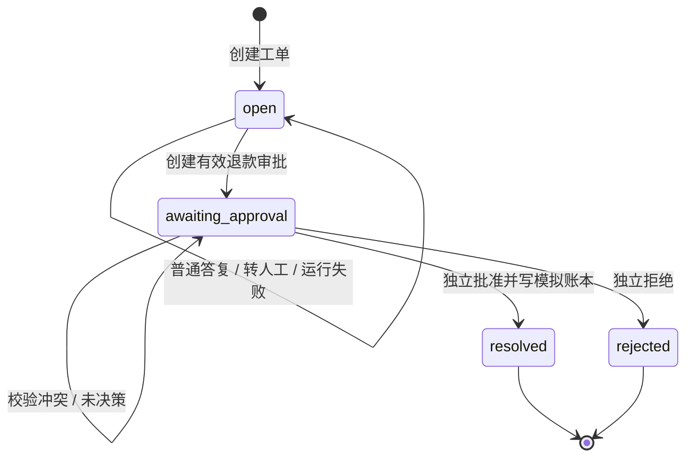
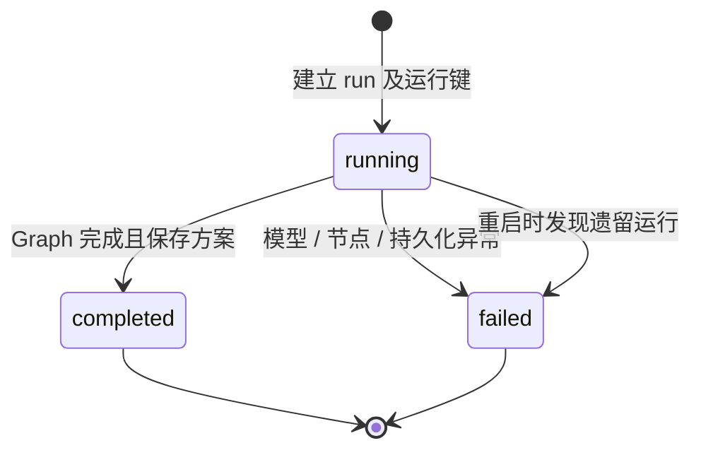
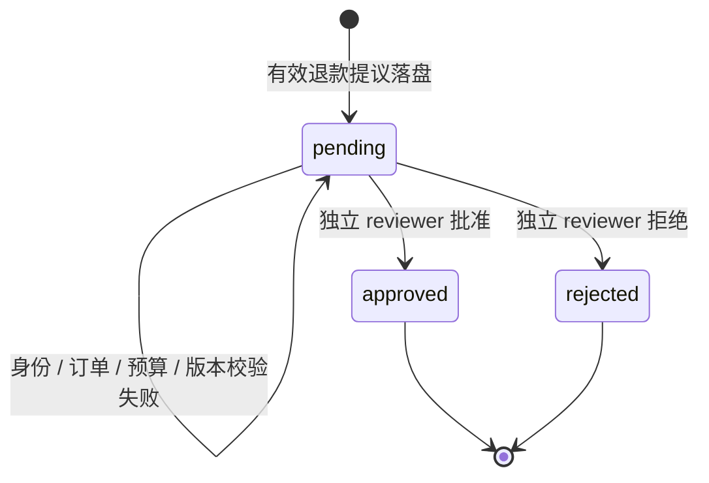

# CaseDesk：架构与验收

源码对照日期：2026-10-26。本文描述当前代码结构、可以复现的检查及明确边界；实际执行记录另行保存，不把测试存在当作已经通过。

## 1. 系统边界

CaseDesk 是本地运行的企业售后工单 Agent 作品。它使用真实 LangGraph 固定流程、FastAPI 服务、SQLite 持久化与 React / TypeScript 工作台。默认 `demo` provider 不调用模型；退款只改变本地模拟账本。



图中的模型、订单查询与审批不是三个自治 Agent。模型只产生方案；工具调用位置由固定图定义；审批由应用 API 和数据库事务执行。

## 2. 五节点与信任边界

| 节点 | 实际行为 | 信任边界 / 落盘信息 |
|---|---|---|
| `intake` | 用关键词识别退款、物流、质保、发票或未知意图；标记部分疑似注入文本 | 工单是非可信输入；关键词检测不是完整安全机制 |
| `retrieve` | 查当前租户、当前文档版本；中文双字/英文 token BM25；意图类别筛选；最多返回四个片段 | 证据保存 `documentId/version/chunkId/text/score`；退款有相关命中时补齐对应政策片段 |
| `order_lookup` | 租户内查订单，检查可退标记、签收与 30 天条件，计算剩余额度/预算 | 订单与预算来自数据库，不由模型传入；时间字段是合成数据中的 `delivery_days` |
| `draft` | demo 使用规则；真实模式调用可配置模型 API；证据不足或检测异常时转人工 | 只接收允许格式的 `answer/proposal`；真实模式发送工单、证据与订单摘要到配置供应商 |
| `policy_guard` | 校验动作枚举、整数金额、引用范围及文本标记、退款意图与当前可退上限 | 有效提议不等于已授权执行；自然语言语义是否受到证据支持尚未证明 |

每个节点通过 `traced` 保存开始时间、完成/失败状态、输入摘要和输出。读取历史 run 是只读检查；不会再次调用模型或执行退款。

模型服务 URL、模型名称、凭据与数据库路径只来自服务端配置，不接受业务 API 覆盖。`CASEDESK_PROVIDER=openai-compatible` 才使用外部模型；要求端点支持 JSON 对象响应，返回内容再经过 Pydantic 校验。

## 3. 分清三个状态机

### 工单状态



只有 `open` 工单允许新运行；同一个工单不能同时拥有两个运行中的任务。`resolved/rejected` 当前都是终态，没有编辑、重开或删除 API。拒绝后需要重新申请时，应新建工单保留旧记录。

### 运行状态



`completed` 只说明本次建议生成流程结束。此时工单可能仍为 `open`，也可能在 `awaiting_approval`。失败重试使用新运行键；已有 key 返回既有记录。

### 审批状态



**没有 LangGraph checkpoint、interrupt 或图内暂停恢复。** 审批是 Graph 结束后的独立 HTTP 请求；已保存的审批与会话可在重启后读取，但运行中节点不会自动续跑。

## 4. 一次批准为什么需要事务

`POST /api/approvals/{id}/decision` 首先要求 reviewer 身份，且执行人与申请人不同。随后在 `Database.connect(write=True)` 的 `BEGIN IMMEDIATE` 事务内完成：

1. 按租户查审批；检查申请人与幂等请求指纹。
2. 确认审批仍为 `pending`。相同 key 和同一请求返回已有响应；不同请求复用 key 返回 `409`。
3. 批准时重读订单资格、订单剩余可退金额、50000 分单笔上限、租户预算和原证据文档版本。
4. 更新订单累计退款，新增唯一绑定审批的模拟退款记录。
5. 更新审批和工单状态，追加审计，保存幂等响应。
6. 一起提交；异常时回滚。

生成方案到人工批准之间，其他审批可能改变余额或预算，因此不能使用生成时的快照直接执行。数据库约束还包括同租户 run key 唯一、同一工单仅一条 `running`、审批关联 run 唯一、退款关联审批唯一。

这些机制约束的是本地数据库内的状态变更。它们不是跨支付供应商、消息系统和数据库的分布式 exactly-once。未来接入真实支付，还需请求幂等、支付状态机、回调处理、对账及补偿设计。

## 5. 部署和持久化范围

| 项目 | 当前行为 | 限制 |
|---|---|---|
| 进程 | Uvicorn 单 worker；请求内同步执行工作流 | 不支持多实例任务调度；不能加 `--workers 2` 后声称部署完成 |
| SQLite | WAL、外键、忙等待、写事务 | 写入串行；没有多机共享、复制、备份恢复或在线迁移方案 |
| 中断恢复 | 启动时将遗留 `running` 标记 `failed` | 不从失败节点续跑，不自动重试外部调用 |
| 会话 | 密码 PBKDF2；随机 token 只存哈希；默认 12 小时有效 | 演示账户固定；未实现生产账号生命周期、MFA 和分布式限流 |
| 运行限度 | 模型 HTTP 超时、返回大小上限、节点前预算检查；工作流时间预算最高 45 秒 | 属于有界调用设计，不是硬实时截止；本地数据库等待等仍可能增加墙钟时间 |
| 知识库 | 只读合成政策，版本与 chunk 绑定 | 尚无文档上传、编辑、重建索引、版本发布 API |
| 记录查询 | 工单/审批/审计有列表数量限制 | 尚未实现完整分页、归档与数据保留策略 |
| 审计 | 应用内追加；SQLite trigger 禁止更新/删除 | 管理员可改数据库或 trigger，不是外部可信或加密防篡改日志 |
| 对外通信 | 仅显式模型 provider 调用；退款写本地账本 | 没有外部客户消息发送、真实支付或物流动作 |

## 6. 可复现的命令

以下命令基于项目已有虚拟环境与依赖；首次安装和启动以仓库根目录 README 为准。它们是操作说明，本文没有把执行命令等同于已经得到某个结果。

在项目根目录运行后端回归测试：

```bash
cd backend
../.venv/bin/python -m pytest -q
```

只复核租户、审批与并发约束：

```bash
../.venv/bin/python -m pytest -q tests/test_api.py -k 'tenant_isolation or approve_is_atomic or concurrent or policy_update'
```

复核模型接口、恶意输出和失败持久化：

```bash
../.venv/bin/python -m pytest -q tests/test_api.py -k 'provider or untrusted_model or prompt_injection or float_amount'
```

前端编译检查，在另一个终端从项目根目录执行：

```bash
cd frontend
npm run build
```

后端单 worker 启动：

```bash
cd backend
../.venv/bin/uvicorn app.main:app --host 127.0.0.1 --port 8000
```

测试夹具使用独立临时数据库；不要为了复现失败场景直接修改日常演示数据库。记录每次验收的代码版本、依赖版本、provider、数据库是否新建、命令、退出码及失败日志。只有拿到真实输出后才在验收记录中填写通过数量。

## 7. 验收维度和现有测试对应关系

以下测试名称在 `backend/tests/test_api.py` 中可查。它们表示已有检查逻辑，不表示本文件发布时每一项均已通过。

| 维度 | 关键验收条件 | 对应现有测试 / 检查方式 |
|---|---|---|
| 登录与会话 | 未登录访问拒绝；密码与 token 不明文入库；注销后会话失效 | `test_health_and_auth`、`test_password_and_token_not_plaintext`、`test_logout_invalidates_session` |
| 租户隔离 | 另一租户不能读取或审批资源，也不能绑定其他租户订单 | `test_tenant_isolation_every_surface` |
| 真实图与证据 | 五节点顺序与节点状态可查；引用包含版本；提议不直接退款 | `test_langgraph_trace_citations_and_pending_state` |
| 独立审批 | 客服不能批准；即使是 reviewer 也不能审批自己的申请 | `test_agent_cannot_approve`、`test_reviewer_cannot_self_approve` |
| 幂等与拒绝终态 | 同键相同请求不重复写账本；同键异参冲突；拒绝不能再批准 | `test_approve_is_atomic_and_idempotent`、`test_run_idempotency_and_conflict`、`test_rejection_terminal_state` |
| 并发金额 | 同键并发仅一个账本；不同审批不能超出订单余额或租户预算 | 三个 `test_concurrent_*` 测试 |
| 低证据与业务边界 | 未知政策转人工；物流与超期订单不创建退款审批 | `test_shipping_expired_and_low_evidence` |
| 非可信模型输出 | 外租户引用、超额金额、浮点/布尔金额不能通过；注入不能获得权限 | `test_untrusted_model_amount_and_citations_rejected`、`test_float_amount_schema_rejected`、`test_prompt_injection_cannot_gain_permission` |
| 政策时点 | 方案引用版本变化后，批准操作拒绝 | `test_policy_update_invalidates_stale_approval` |
| 回放与审计 | 多次读取不重新执行；普通 SQL 更新/删除审计受到 trigger 拒绝 | `test_trace_replay_read_only_and_audit_append_only` |
| 重启持久化 | 已保存结果、审批、会话、账本可读；遗留运行标为失败 | `test_service_restart_preserves_runs_approvals_sessions_and_ledger`、`test_interrupted_run_marked_failed_on_restart` |
| 失败与输入约束 | 模型异常保留失败轨迹，不泄漏异常细节；体积/字段限制生效 | `test_provider_failure_persists_failed_trace`、`test_input_limits_and_extra_fields` |
| 请求中可观察性 | 其他请求能读取运行中记录；同工单并发运行受阻止 | `test_running_trace_is_readable_and_same_ticket_cannot_race` |
| 模型适配器 | HTTP 请求/响应契约、模型名、凭据与结构解析正确 | `test_openai_compatible_provider_request_and_response`；**MockTransport，不是真实模型评测** |

## 8. 浏览器手工验收脚本

使用根 README 中的演示账号，在明确的演示数据库执行。每一步保存实际观察，不能只凭按钮点击判断完成。

1. 登录极光数码客服，检查工作空间、演示标识和工单列表；查看另一工作空间时应重新登录对应身份。
2. 运行“耳机已签收，希望申请退款”，检查处理建议、政策引用、五节点轨迹和待审批状态；模拟退款总额此时不应增加。
3. 查看审批中心，客服应不能执行退款；切换独立 reviewer，核对证据后批准，确认工单 `resolved`、模拟账本统计增加、审计出现批准与模拟退款事件。
4. 新建另一张合格退款工单，运行后拒绝；确认终态 `rejected`，无对应退款增加。
5. 运行物流、超期退款、国际关税等样例，检查普通回复或转人工提示与无退款审批；不要把“已完成运行”理解成“业务退款完成”。
6. 切换海港生活账号，确认只显示本租户工单、知识和审计；直接访问跨租户 API 的验证由后端测试负责。
7. 打开历史执行，确认内容来自保存记录；重复查看不应新增审批、账本或执行事件。
8. 在独立测试配置下制造模型失败，检查页面有可读错误、仍可导航，后端保留失败状态；不能让对象形式的错误值导致界面崩溃。
9. 重启服务后重新读取结果，确认持久化；服务启动记录中的遗留执行失败应清楚可见。
10. 小屏宽度与键盘操作检查：弹窗、表单错误、按钮忙碌态、空列表和长证据应可读可操作。

## 9. 仍待完成的真实模型评测

当前 mock provider 和确定性 demo 只能证明代码路径与若干业务约束。即使真实接口连接成功，也只证明连通性，不能代替效果评测。

下一轮建议冻结独立的留出案例，并为每题预先写出：预期动作、允许金额范围、可引用政策、必须转人工的条件。案例应包含正常退款、物流咨询、超期/运输中订单、无证据、同义改写、政策冲突、恶意指令及格式异常等。输出至少分为：

- 模型方案是否正确，以及引用是否在语义上支持答复；
- 业务控制是否阻断非法提议；
- 人工复核能否据证据做决定；
- 同一配置下延迟、错误、token/费用与失败类型。

真实模型、数据集、运行日志和人工标注尚未形成以前，不报告“准确率”“拒答率”“节省人力”或相对基线的提升。后续对照必须使用同样证据、同一模型与同一案例，避免把更好的检索、模型差异和控制层效果混成一个数字。

## 10. 关键源码索引

- [工作流与 provider](../backend/app/agent.py)：图、检索、订单工具、模型调用、策略校验和轨迹。
- [API 与审批事务](../backend/app/main.py)：会话、租户、运行幂等、独立审批与启动恢复。
- [数据模式与事务](../backend/app/db.py)：约束、WAL、合成数据、审计 trigger。
- [输入与输出契约](../backend/app/models.py)：严格字段、动作枚举和整数金额。
- [自动化测试](../backend/tests/test_api.py)：工程行为的可执行检查。
- [前端工作台](../frontend/src/App.tsx)：用户操作、证据与轨迹展示。

交付结论应使用“在声明环境下完成了哪些实际验收”，不使用“生产级”“金融级”“完全安全”等超出证据的标签。
