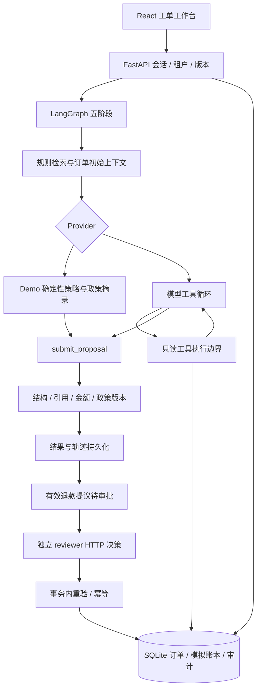
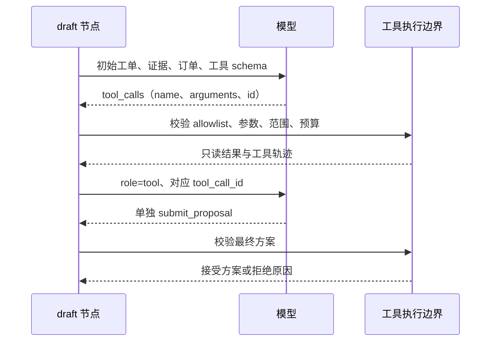
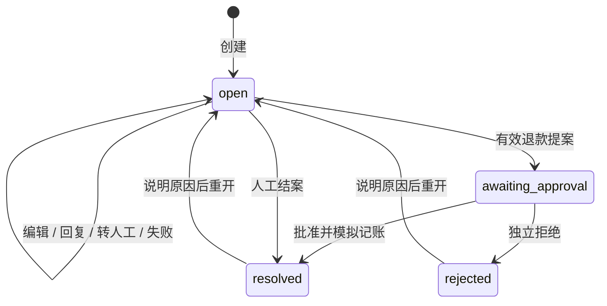

# CaseDesk：架构、状态与验收依据

本文对应 v2 实现，关注每个组件负责什么、约束在哪里执行，以及如何验证。启动和完整字段契约见 [后端说明](../backend/README.md)，本轮实际结果见 [验收记录](验收记录.md)。

## 1. 从模型建议到业务决定

模型负责提出可审阅的方案，业务层决定是否有权限形成审批、是否允许实际写账本。初始上下文查询和模型后续查询使用同一个工具入口；模型的租户、角色和订单范围不由提示词授予。

人工审批不是 LangGraph `interrupt`：图运行结束后保存待审批记录，reviewer 通过独立 API 请求决定。当前没有 checkpointer、图内暂停恢复或多 Agent 协作。

## 2. 外层阶段与内层循环

| 外层节点 | 行为 | 关键约束 |
|---|---|---|
| `intake` | 识别退款、物流、质保、发票或未知意图；标记部分可疑指令 | 关键词是辅助判断，不是通用注入检测器 |
| `retrieve` | 已知意图时调用 `search_policies` 取得初始片段 | 当前租户、当前文档版本；疑似注入不自动查询 |
| `order_lookup` | 工单有绑定订单时调用 `lookup_order` | 必须是工单绑定且属于当前租户的订单 |
| `draft` | demo 生成确定性提案；模型模式可补检索、查单并最终提交 | 最多 6 次模型请求、10 次工具调用；不能任意运行代码或支付 |
| `policy_guard` | 检查最终 schema、引文、动作、金额与版本 | 通过只代表方案合规，仍需独立审批 |

内层消息序列：

这是一种受业务约束的工具循环，初始检索和查单仍由固定阶段发起。模型可选择是否补查、补查什么；不能跳过业务校验或定义新工具。最终 JSON 文本也经过同一提交入口，不构成绕过工具校验的后门。

工具 schema 在 [`agent_tools.py`](../backend/app/agent_tools.py)，HTTP 适配在 [`provider.py`](../backend/app/provider.py)。参数拒绝未知字段、重复 JSON 键和非有限数值；金额使用严格整数。`submit_proposal` 必须单独提交，不能和另一个工具组成一批。

协议或权限拒绝会结束自动建议，返回 `abstain` 并记录 `terminationReason`。供应商 HTTP 错误与超时保存为失败 run。拒绝、超时都不会偷偷切换 demo 并伪装为真实模型成功。

## 3. 证据与业务时间

检索使用中文双字切分、英文 token 与 BM25；初始检索带意图类别筛选，模型补查可选择类别。单次最多 4 片，累积上下文最多 8 片。退款相关命中会补充同版本的退款限制片段。模型运行中重新检索到某文档的新版本，会替换当前上下文中的旧版片段，之前的工具结果仍保留在轨迹中。当前没有 embedding、向量数据库或重排器。

证据保存 `documentId/title/category/version/chunkId/text/score`。回答中的 `[chunkId]` 与方案引用必须一致且来自此次证据；退款提议至少引用退款类别。这个检查约束引用范围，不逐句证明语言断言。

版本分为两类：

| 对象 | 写入规则 | 作用 |
|---|---|---|
| 工单 `version` | 编辑、状态变化及运行相关更新推进；编辑/状态请求带 `expectedVersion` | 防止旧表单覆盖新状态；运行保存输入时的工单版本 |
| 政策 `version` | reviewer 显式发布；当前指针、历史版本、片段与审计原子写入 | 新检索使用最新版本；历史 run 保留当时证据 |

发布时按空行和 600 字符分片，最多 32 片。旧片段不删除。v2 迁移仅能保存迁移时仍存在的政策版本，不声称恢复此前未记录的历史。

退款正文与服务端资格/金额策略绑定，只允许更新标题来形成新版本；非退款指导可以修改正文。即使只改标题，旧审批也会因版本变化被阻止，这是当前保守的失效策略。政策正文不会自动转换成可执行金融规则。

订单使用 `delivered_at` 计算已签收天数；旧库升级时按旧 `delivery_days` 一次推导日期，以后不随重启重置。批准时重新计算时间，避免方案生成时合格、实际批准时已经超期。

## 4. 三种状态不能混为一谈

### 工单

有运行或待审批时禁止编辑和手工状态变化。只有 `open` 可新运行，同工单不能同时存在两个活动 run。重开不撤销账本、删除审批或清空订单累计退款。

### 运行与审批

| 对象 | 状态转换 | 如何理解 |
|---|---|---|
| run | `running → completed` | 建议生成结束；动作可能是回复、转人工或退款提议 |
| run | `running → failed` | 网络、执行异常或进程中断；保留已写轨迹 |
| approval | `pending → approved / rejected` | 只有独立 reviewer 能决定；已决定记录不修改 |
| approval | `pending → pending` | 余额、资格、版本或其他校验失败；未记账 |

`run.completed + ticket.awaiting_approval` 是正常状态。受控拒答也可能是 `run.completed + action.abstain`；“流程完成”不等于“模型回答正确”，更不等于“退款完成”。

## 5. 为什么批准要重新开启事务

在 `BEGIN IMMEDIATE` 写事务中：

1. 按当前租户定位审批，要求 reviewer 且不能自审；核对幂等请求指纹。
2. 相同 key、相同请求回放已有响应；异参复用返回 409。未决定的审批才进入执行。
3. 重读订单资格与签收日期、剩余金额、单笔 50000 分上限、租户累计 100000 分预算和政策版本。
4. 更新订单退款额，插入唯一绑定审批的模拟账本记录。
5. 一起更新审批、工单、事件、幂等响应和审计，然后提交；异常全部回滚。

模型建议到人工决定之间，其他审批可能消耗余额，政策可能更新，订单也可能跨过退货窗口，因此不能依赖生成时的快照。数据库另有运行 key 唯一、单工单单活动 run、审批关联 run 唯一、退款关联审批唯一等约束。

这约束的是一个本地数据库事务。真实支付仍需要供应商幂等、支付状态机、回调、补偿和对账，不能直接从本地账本测试推导分布式 exactly-once。

## 6. 轨迹、指标与中断

运行保存两层轨迹：`steps` 是外层阶段，`toolCalls` 是实际工具请求；工具来源为 `bootstrap / demo / model`。轨迹包含已校验参数、结果、状态与时间，不是模型内部思维链。每次工具完成或拒绝都会持久化，查询历史不会重复调用。

指标包括模型请求次数、工具次数、墙钟耗时、供应商报告的 token usage 和报告 usage 的请求数量。没有报告 usage 时为 `null`，不是 0 费用；只有部分请求报告时，token 总量也只覆盖这些请求。demo 模型请求数为 0。

预算是 `min(45, max(5, model_timeout + 5))` 秒，默认 25 秒；在节点、工具、循环与响应读取处检查。它不是强制取消线程的硬实时截止，数据库等待等仍可能延长总时间。

单应用 worker 启动时将遗留的 `running` run、节点和工具标为失败，记录一次中断事件。已保存的记录可回看，新运行需新 key；没有从中断节点自动续跑。SQLite 的审计、工单事件和政策历史有防更新/删除 trigger，但数据库管理员仍可改变底层数据，不能称为外部可信防篡改存储。

## 7. 按机制定位验收

| 验收问题 | 可执行依据 |
|---|---|
| 工具由模型主动补查，并以对应 ID 回传吗？ | [`test_agent_v2.py`](../backend/tests/test_agent_v2.py)：补查、多轮协议、同批/跨轮重复 ID、提交独占 |
| 越界工具、金额、引用和预算是否受控？ | 同文件：allowlist、订单范围、参数、轮次/工具预算、版本变化；[`test_api.py`](../backend/tests/test_api.py)：金额、引用和审批约束 |
| 修改和重开会抹掉旧记录吗？ | [`test_workflow_v2.py`](../backend/tests/test_workflow_v2.py)：乐观锁、补充信息、重开保留账本与审批 |
| 发布是否保留版本并阻止旧提案？ | 同文件：角色权限、旧版本保留、正文保护、旧审批失效和新检索 |
| 并发和故障是否造成超额或部分写入？ | `test_api.py`：重复审批、同订单/租户预算竞争、持久化和重启 |
| 签收时间会随日期改变吗？ | `test_workflow_v2.py`：批准时重验、无数据库写入的日期推进、旧库迁移 |
| UI 是否真正完成业务链？ | [`workflow.spec.ts`](../frontend/tests/workflow.spec.ts)：本地 API 闭环、错误态、移动端和 v2 流程 |
| 模型建议是否语义正确？ | 需要另做[真实模型留出评测](真实模型评测清单.md)；上述测试不替代它 |

全套复现命令见根 README。pytest 和评估使用临时数据库，E2E 使用独立 `8001 / 5174` 服务。每轮记录代码版本、provider、环境、命令与实际输出；测试存在不代表本轮已经通过。

## 8. 工程取舍与下一步

当前刻意控制在单 worker、本地 SQLite 和小型文本政策库范围内，便于审阅事务、权限与工具协议。它没有生产账号生命周期、任务队列、多实例调度、外部业务集成或数据保留治理。

下一步先跑真实模型留出评测，分清检索缺失、工具误选、引用误用与业务状态错误，再选择改动。若转向线上部署，数据库迁移管理、队列恢复、身份管理、外部副作用与观测需要作为完整工程任务设计，不能只切换数据库或增加一个框架就宣称完成。
